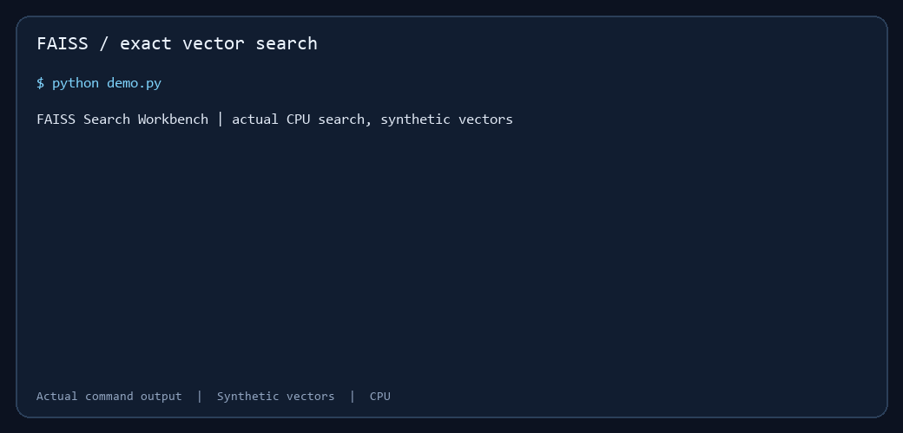

# FAISS Search Workbench

**Search your vectors without confusing distance, similarity, or document IDs.**

A small exact CPU-search adapter and JSON CLI built around [Faiss](https://github.com/facebookresearch/faiss). Compare cosine, squared L2 and inner product; use your own string IDs; get only real neighbors even when `k` exceeds the corpus size. No model service or API key is required.



The animation renders actual command output from `demo.py`. Its two-dimensional vectors are hand-written teaching fixtures, **not embeddings or model-quality results**. [Recording and source hashes](docs/demo-recording.json).

## Run it in two minutes

Python 3.11+ and a supported `faiss-cpu` wheel are required. The test matrix covers Python 3.11 and 3.13 on Windows and Linux.

```bash
git clone https://github.com/smgpulse007/faissNNSearch.git
cd faissNNSearch
python -m venv .venv
```

Activate on macOS/Linux with `source .venv/bin/activate`, or in Windows PowerShell with `.venv\Scripts\Activate.ps1`. Then:

```bash
python -m pip install -r requirements.txt
python demo.py
python search.py --data examples/vectors.json --queries examples/queries.json --metric cosine -k 3
python -m unittest discover -s tests -v
```

No activation is necessary if you use `.venv/bin/python` (macOS/Linux) or `.venv\Scripts\python.exe` (Windows) in place of `python`.

The demo searches `[1, 0]` against three vectors. Cosine ranks `[10, 0]` first because it points in the same direction; L2 ranks `[1, 0.2]` first because it is the nearest point. The scores are calculated by Faiss on every run.

## Use your own vectors

Corpus JSON has exactly two keys. IDs must be unique, nonempty strings:

```json
{"ids": ["guide/setup", "guide/testing"], "vectors": [[1, 0], [0.2, 1]]}
```

Query JSON is a matrix, including for a single query: `[[1, 0]]`. Generate document and query vectors with the **same embedding model and dimensions** before using this tool. It does not create embeddings, parse documents, retrieve web pages, or establish semantic relevance.

```python
from vector_search import VectorIndex

index = VectorIndex([[1, 0], [0.2, 1]], ["guide/setup", "guide/testing"], metric="cosine")
for neighbor in index.search([[1, 0]], k=5)[0]:
    print(neighbor.id, neighbor.score)
```

`search()` accepts a two-dimensional numeric NumPy array or rectangular list, returns one list of `Neighbor` records per query, and copies input arrays. Noncontiguous arrays are supported. Values must remain finite in float32. Cosine rejects zero vectors and normalizes both sides without changing caller data.

| `--metric` | Returned `score_kind` | Best score | Normalization |
| --- | --- | --- | --- |
| `cosine` (default) | `cosine_similarity` | Highest | Corpus and queries |
| `l2` | `squared_l2_distance` | Lowest | None |
| `inner_product` | `inner_product` | Highest | None |

These semantics follow the [Faiss metric guide](https://github.com/facebookresearch/faiss/wiki/MetricType-and-distances). L2 scores are **squared** distances. Inner product is not cosine unless both vectors are normalized. Floating-point ties have no ordering guarantee; scores use float32 arithmetic. Overflowing search scores are rejected with rescaling guidance.

## CLI contract

- Successful searches print JSON to stdout and exit `0`. Results include metric, score meaning, corpus size, requested `k`, and returned count.
- Invalid inputs exit `2` with a JSON error on stderr; argument-parser usage errors also exit `2`. No partial search results are emitted.
- Each JSON file is limited to 8 MiB. UTF-8 (with an optional BOM) is accepted; duplicate keys, non-finite values, excessive nesting, malformed matrices, and mismatched dimensions are rejected.
- `k` must be a positive integer. If it is larger than the corpus, each query returns the entire corpus, without Faiss's `-1` padding accidentally mapping to the last document.

## Development

`example.py` is the original 1,000-vector flat-L2 tutorial, unchanged. Run it with `python example.py`.

The focused suite exercises actual Faiss, independently compares all three metrics against NumPy, runs the CLI in subprocesses, and checks invalid inputs and caller-array preservation. It does not benchmark speed, test GPU search, or validate real-world retrieval quality. Exact flat search stores the full corpus in memory and scans every vector; use Faiss's larger index families when that tradeoff no longer fits.

Runtime dependencies are pinned in `requirements.txt`; update from `requirements.in` using `uv pip compile requirements.in --python-version 3.11 --output-file requirements.txt`, then run the suite on supported platforms. The lock intentionally targets Python 3.11 compatibility.

To regenerate the demo after a source change:

```bash
python -m pip install Pillow
python scripts/record_demo.py
```

The renderer runs the demo and tests before writing a GIF, records their actual output, and hashes source text with LF line endings. CI only installs dependencies and runs checks; it publishes no image, package, or deployment.

## License

This repository does not yet contain an established license file. Faiss and other dependencies retain their own licenses; they do not automatically license this repository's code.
